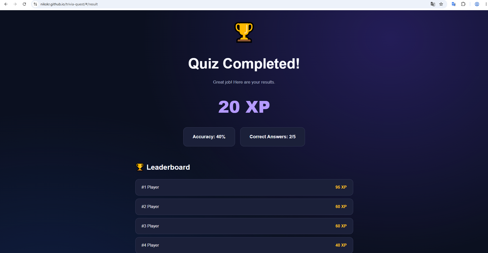

# Trivia Quest

A quiz game built on the [Open Trivia DB API](https://opentdb.com/api_config.php).
Pick a category, difficulty and number of questions, answer them, earn points and get on the leaderboard.

**Deploy:** https://nikskr.github.io/trivia-quest/



## Features

- Categories loaded from the API (cached in memory)
- Difficulty: Easy / Medium / Hard, 5 to 20 questions per game
- Scoring: 10 / 20 / 30 points per correct answer by difficulty
- Results: XP, accuracy, correct answers and a top-10 leaderboard saved in localStorage
- Error handling: API rate limit (1 request per 5 seconds), not enough questions, 8-second timeout,
  no connection, with a Retry button for categories
- HTML entities in questions (`&quot;`, `&amp;`, `&lt;`…) are decoded without using the DOM

## Tech stack

- TypeScript, no frameworks
- Copyfiles for `index.html`, `styles.css`
- DOM built with `createElement` / `textContent`, no `innerHTML`
- Vitest for unit tests
- ESLint, Prettier, Husky + lint-staged (lint and format on commit, tests on push)
- GitHub Actions → GitHub Pages (lint, format check, tests and build on every push to `main` and `dev`)

## Getting started

Requires Node.js

```bash
npm install
npm run lint        # ESLint
npm run format      # Prettier
npm test            # unit tests
npm run build       # compile TypeScript, copy files to dist/
```

The build output in `dist/` uses ES modules, so serve it with a local server, e.g. `npx serve dist`.

## Project structure

| Path               | Contents                                                                                                          |
| ------------------ | ----------------------------------------------------------------------------------------------------------------- |
| `src/api/`         | `buildQuizUrl`, `fetchQuestions`, `fetchCategories`, `mapApiQuestion`, `decodeHtml`, `HttpError` / `QuizApiError` |
| `src/game/`        | `shuffleAnswers`, `calculateScore`, `gameReducer`, records (localStorage)                                         |
| `src/ui/`          | `getErrorMessage`, `parseSettings` — pure helpers for screens                                                     |
| `src/pages/`       | screens: About, Settings, Question, Result                                                                        |
| `src/router.ts`    | hash router                                                                                                       |
| `src/main.ts`      | app entry: routes, game state, wiring API → game logic → UI                                                       |
| `docs/smoke-test/` | smoke test report and screenshots                                                                                 |

## How we worked

- Tasks on a Kanban board in Jira, split into epics: setup, API, game logic, UI and integration, interviews
- One task = one branch = one pull request (some tasks are divided on multiple PR); the Jira key is in the branch name and PR title
  (`feat/TS-12-fetch-questions`, `TS-12: fetchQuestions...`)
- `main` is protected: changes are merged only via PR with an approval from the teammate
- Commits follow the convention `<type>: <what was done>`
- Logic is written with TDD: a commit with failing tests first, then the implementation
- Dependencies such as `random`, `fetch` and data loaders are passed as arguments,
  so functions are tested without network or DOM

## Testing

- **Unit tests:** `npm test` — API functions, game logic and UI helpers
- **Smoke test** on the deployed version: [docs/smoke-test/SMOKETEST.md](docs/smoke-test/SMOKETEST.md)

## Team

| Member                                               | Area                                                                           |
| ---------------------------------------------------- | ------------------------------------------------------------------------------ |
| **Mikita** ([@nikskr](https://github.com/nikskr))    | API and data: requests, errors, response mapping, settings screen, integration |
| **Sanat** ([@sanat135](https://github.com/sanat135)) | Game logic: shuffling, scoring, reducer, records, question and result screens  |
